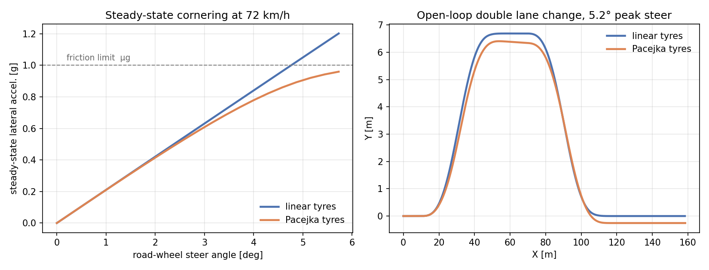

# vehicle-dynamics-python

**Single-track (bicycle) vehicle models for control and reinforcement learning.** Linear, path-error, and nonlinear models with a Pacejka tyre, plus linearization, discretization, standard steering maneuvers, and tests that check the physics.

[](https://github.com/FarzanehTatari/vehicle-dynamics-python/actions/workflows/tests.yml)
[](https://www.python.org/)
[](LICENSE)
[](pyproject.toml)
[](https://doi.org/10.5281/zenodo.23445678)



*Left: linear tyres predict lateral acceleration that keeps climbing past the friction limit. Pacejka tyres saturate. Right: the same open-loop double lane change. Once the tyres saturate, the linear model overestimates the response and misses the drift.*

---

## Why this exists

Almost every project on learning-based or model-predictive vehicle control needs a lateral vehicle model, and almost every one reimplements it from a textbook. The reimplementations disagree on sign conventions, mix per-tyre and per-axle cornering stiffness, and are rarely tested.

This library provides those models once, with:

- **One documented convention.** ISO 8855 axes, per-axle cornering stiffness, stated in every docstring.
- **Tests that check physics, not just code.** The nonlinear model linearizes to exactly the linear one. Steady-state cornering satisfies the understeer relation. Oversteering vehicles go unstable above their critical speed. Exact discretization matches simulation.
- **numpy as the only dependency.**

## Install

```bash
git clone https://github.com/FarzanehTatari/vehicle-dynamics-python.git
cd vehicle-dynamics-python
pip install -e .               # library only
pip install -e ".[dev]"        # plus pytest and matplotlib
```

## Quick start

```python
import numpy as np
from vehicle_dynamics import LinearBicycle, midsize_sedan, simulate, step_steer

params = midsize_sedan()
model = LinearBicycle(params, vx=20.0)          # 72 km/h

t = np.arange(0.0, 5.0, 0.01)
result = simulate(model, x0=[0.0, 0.0], t=t, u=step_steer(0.02))

print(result["r"][-1])                          # steady-state yaw rate [rad/s]
print(params.understeer_gradient)               # K_us [rad/(m/s^2)]
print(params.characteristic_speed)              # [m/s]
```

### For MPC: the path-error model, discretized

```python
from vehicle_dynamics import LaneKeepingErrorModel, discretize

plant = LaneKeepingErrorModel(params, vx=20.0)  # x = [e_y, e_y_dot, e_psi, e_psi_dot]
Ad, Bd = discretize(plant.A, plant.B, dt=0.05)  # zero-order hold
_, Ed = discretize(plant.A, plant.E, dt=0.05)   # road-curvature disturbance
```

### Nonlinear model with saturating tyres

```python
from vehicle_dynamics import NonlinearSingleTrack, PacejkaTire, sine_with_dwell

car = NonlinearSingleTrack(
    params,
    front_tire=PacejkaTire.from_stiffness(params.cf, params.fz_front, mu=1.0),
    rear_tire=PacejkaTire.from_stiffness(params.cr, params.fz_rear, mu=1.0),
)
x0 = [0, 0, 0, 25.0, 0, 0]                      # [X, Y, psi, vx, vy, r]
result = simulate(car, x0, np.arange(0, 6, 0.005), sine_with_dwell(0.08))
```

`PacejkaTire.from_stiffness` matches the linear tyre's slope at zero slip, so the two models agree for small inputs and only part ways where saturation begins.

## What's inside

| Module | Contents |
| --- | --- |
| `params` | `VehicleParams` with axle loads, understeer gradient, characteristic and critical speed, steady-state yaw gain. `midsize_sedan()` preset (Rajamani 2012). |
| `models` | `LinearBicycle` (`[vy, r]`), `LaneKeepingErrorModel` (`[e_y, ė_y, e_ψ, ė_ψ]` with curvature disturbance), `NonlinearSingleTrack` (`[X, Y, ψ, vx, vy, r]`, exact slip kinematics, optional longitudinal force). |
| `tires` | `LinearTire`, `PacejkaTire` (Magic Formula, with peak-slip computation). |
| `linearize` | Central-difference `linearize(model, x0, u0)` for any model; `discretize(A, B, dt)` with exact zero-order hold or Euler. |
| `maneuvers` | `step_steer`, `ramp_steer`, `sine_steer`, `lane_change`, `double_lane_change`, `sine_with_dwell` (FMVSS 126 / UN R140). |
| `simulate` | Fixed-step RK4 with zero-order-hold inputs; results indexable by state name. |

## Conventions

- **Axes:** x forward, y left, z up (ISO 8855). Positive yaw and positive steer turn left.
- **Cornering stiffness is per axle.** If your source gives a per-tyre value `Cα`, use `cf = 2 * Cα`.
- **Steer angle is the road-wheel angle,** not the handwheel angle. Divide by the steering ratio.
- **Slip angle sign:** positive slip produces positive lateral force.

## Scope and limits

These are **planar single-track models**. They lump each axle's two tyres into one, and they do not model roll, pitch, load transfer, combined longitudinal and lateral slip, or tyre relaxation. They are the right tool for lateral control design, RL environments, and teaching. They are the wrong tool for limit handling near rollover or for anything that depends on left/right load differences.

The `lane_change` and `double_lane_change` maneuvers are **open-loop steering profiles**. They are not the ISO 3888 test, which is closed-loop path following through a cone course.

## Tests

```bash
pytest
```

44 tests, under a few seconds. Each test asserts something a vehicle dynamicist would expect to be true. See `tests/test_models.py` for the physics checks.

## References

- R. Rajamani, *Vehicle Dynamics and Control*, 2nd ed., Springer, 2012.
- H. B. Pacejka, *Tire and Vehicle Dynamics*, 3rd ed., Butterworth-Heinemann, 2012.
- ISO 8855:2011, *Road vehicles — Vehicle dynamics and road-holding ability — Vocabulary*.

## Related work

This library grew out of the vehicle model used in [hybrid-sac-mpc-lateral-control](https://github.com/FarzanehTatari/hybrid-sac-mpc-lateral-control) ([arXiv:2608.17258](https://arxiv.org/abs/2608.17258)), rewritten from scratch as a standalone, tested package.

## Author

**Farzaneh Tatari** · [Website](https://farzanehtatari.github.io) · [Google Scholar](https://scholar.google.com/citations?user=kocqXnAAAAAJ) · [LinkedIn](https://www.linkedin.com/in/farzaneh-tatari-75296a115/)

## License

MIT. See [LICENSE](LICENSE).
